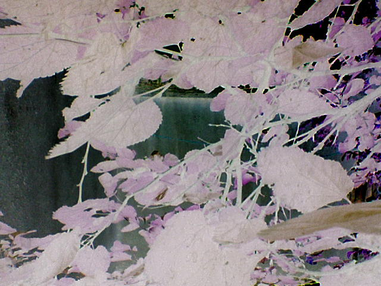
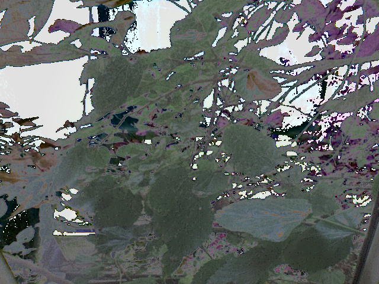
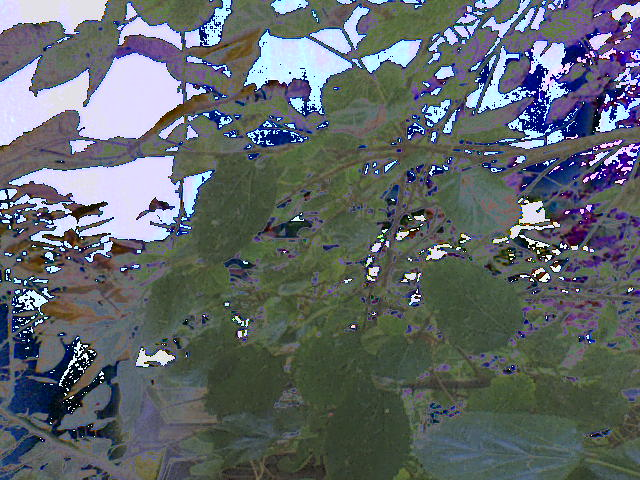
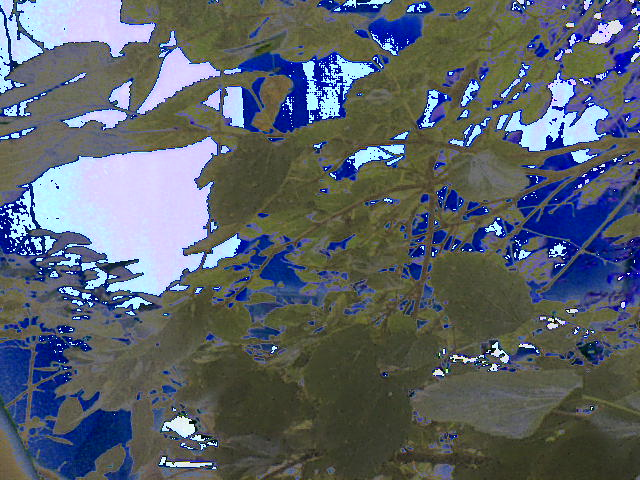

# A Few More Effects for the W200i

Experimental camera effects for the Sony Ericsson W200i, created by modifying camera driver register values. These modifications replace the original Negative effect with alternative in-camera visual effects.

## Effects

### Effect 01

### Effect 02

### Effect 03

### Effect 04

## Requirements

- Sony Ericsson W200i (CID52 RED)
- Firmware: R4JA011
- XS++ 3.2
- Gordon's Gate USB Flash Driver
- Windows PC and USB cable

## Installation

### 1. USB Driver

Install the Gordon's Gate USB Flash Driver using the files in `USB-Drivers/`. The included `ggsemc.inf` can be installed through Windows Device Manager.

### 2. Connect the Phone

1. Turn off your phone.
2. Hold down the **C** button.
3. Connect the phone to your PC using the USB cable.
4. Open XS++ 3.2 and click **Connect**.

### 3. Replace the Camera Driver

1. Select **FSX** under Configuration.
2. Click **Start FSX** and wait for File System Explorer to load.
3. Navigate to `/ifs/settings/camera/`.
4. Select `camdriver0.dat` under Enumerated Files and click **Delete**.
5. Drag and drop the modified `camdriver0.dat` from your chosen effect folder into the camera directory.
6. Wait for the **Upload Done** message.

### 4. Finish

1. Click **Shutdown** in XS++.
2. Disconnect your phone.
3. Turn it on and select **Negative** in the camera effects menu.

**Important:** Back up your original camera driver before replacing it. Only one modified effect can be installed at a time.

## Credits & Usage

Feel free to use, modify, and share these files. Attribution to **cruacl** is appreciated when using or sharing this work.
